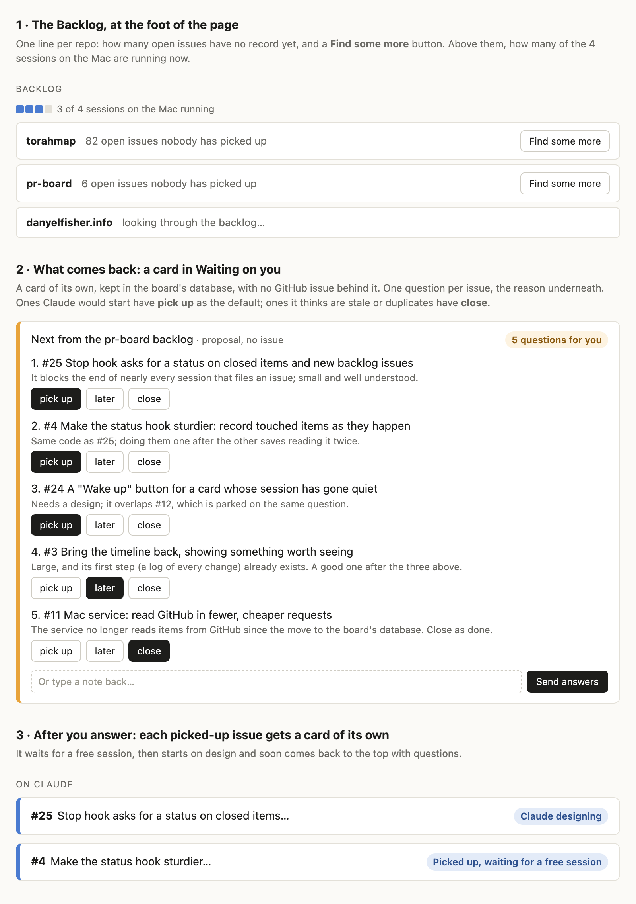

# PR Board: "Find some more" from the backlog

Date: 2026-11-25. Status: second draft for Danyel's review. Issue #18.

## The problem

Many open issues have nobody working on them (84 in torahmap today, 6 in pr-board), and the board offers no way to say "start on some of these". Today each one needs a Claude session opened by hand. The first design planned a Backlog list with a **Pick up** button per issue; that was never built.

## What Danyel chose

On the board, on 2026-11-25:

- **C first: Claude proposes the next few.** One button starts a session that reads the backlog and comes back with a card: "here are the ones I'd do next, and why", one question per issue. His answers pick them up. It doubles as a tidy-up, since with this many issues some are likely stale or duplicates.
- **At most 4 sessions open at once.**

Then, on the first draft of this design:

- **The proposal card is a card of its own on the board, with no GitHub issue.** His note: "the right answer is something in the database, not a new issue that encompasses other issues — that's just leading to chaos." This draft keeps the whole proposal, its answers and the picked-up issues waiting for a session in the board's database; nothing new appears on GitHub except the `in-progress` labels and the closes he chose.
- **What the 4 counts** went to its own issue (#27). Until that is settled, the 4 means sessions running on the Mac at once, the first draft's default.

The per-issue Pick up button (A) and "pick up the next N" (B) are left for later. Both would reuse the pick-up step below, so either is a small addition afterwards. (A note on B: the issue worried that many issues lack a priority label. In torahmap 83 of the 84 open issues have one, so B is more workable than the issue said.)

(The issues on the mockup's card are real pr-board issues, but the picks and reasons are only examples; nobody has checked them.)

## Why a database row is cheaper than the first draft feared

The first draft said a card with no issue would take roughly twice the build, because the record, the status command, the watcher and the Mac service all name a piece of work by its issue or PR number. That is true only if the proposal card is squeezed into the existing record and goes through the existing answer path.

It doesn't need to. A proposal is a different kind of thing from a piece of work: it has no gates, no PR, and no Claude session waiting on its answers. So it gets its own table, and its answers are carried out by the Mac service directly, not by a Claude session. The record, the watcher and the answer path for pieces of work stay as they are. What is new is one table for proposals, one for picked-up issues waiting for a session, and the code that reads and writes them.

## How it works, end to end

1. **Danyel presses "Find some more"** on a repo's line in the Backlog section at the foot of the page. The line also says how many open issues in that repo have no record and nobody's `in-progress` label. Above the lines: how many of the 4 sessions are running on the Mac now.
2. **The board adds a proposal row** (repo, time asked). It refuses a second one for a repo that already has a proposal open, and the repo's line says "looking through the backlog…" until the card appears.
3. **The Mac service starts a session for it**, the same way it starts one for answers: `claude -p` with a prompt, as Claude's own GitHub account, counted against the limit of 4. The session only reads, so it runs in a fresh worktree on the default branch and makes no commits.
4. **The session reads the backlog**: the open issues with no record and no `in-progress`, their labels, ages and comments, the recent merged PRs, and the repo's earlier proposals from the board (so an issue Danyel said "later" to isn't proposed again for two weeks). It picks:
   - up to **5 to pick up**, each with a one-line reason (why this one, why now, what it is close to);
   - any number of **issues to close**, each with a one-line reason (done by an earlier PR, a duplicate of #N, no longer wanted).
5. **It writes the proposal to the board** with a new command, `pr-status propose <owner/repo> --item "#25 | pick up | reason" --item "#11 | close | reason" …`, and ends. The row now holds the list, and the card appears in Waiting on you.
6. **The card** shows one question per issue, the issue's title, the reason underneath, and the choices (pick up | later | close) with Claude's suggestion as the default. Its title is "Next from the pr-board backlog", with no issue number. Danyel answers as on any card, and the answers are saved on the same row.
7. **The Mac service carries out the answers itself**, on its next look, with no Claude session:
   - **pick up**: adds the `in-progress` label on GitHub and a row to the pick-up table. The issue's card appears in On Claude, "Picked up, waiting for a free session".
   - **close**: closes the issue on GitHub with a comment giving the reason and saying it was closed from a backlog proposal on the board.
   - **later**: nothing; the answer stays on the row, which step 4 reads.
   - Then it marks the proposal done, and the card leaves the page.
8. **The Mac service starts a session for each pick-up** when one of the 4 is free, oldest first, with answers waiting going ahead of pick-ups, so an item Danyel answered isn't stuck behind new work. The session is told: Danyel picked this up from the backlog; start with design (`--gate design --state working`), and end with design complete or paused with questions. It uses the worktree and branch `issue-N`, as today. Its first status creates the normal record, and the pick-up row is marked started, so the "waiting" card gives way to the normal one.

If a step fails (the session dies before writing a proposal, or GitHub refuses a close), the proposal goes back to Danyel with a line saying what went wrong, the way a gave-up answer does now.

## The pieces to build

- **Board database**, a new migration with two tables:
  - `proposal`: repo, asked at, session started at, written at, the list (issue, title, suggestion, reason for each), answered at, the answers, the note, done at, and what went wrong if anything did.
  - `pickup`: repo, issue, which proposal it came from, asked at, session started at. (A and B later add rows here directly.)
- **Board HTTP interface**: Danyel's sign-in may ask for a proposal and answer one. The service token may list proposals waiting for a session, claim one (one safe update, as answers are claimed), write its list, list answered proposals, mark one done or failed, and list and claim pick-ups. The page's data gains the Backlog counts per repo, the open proposals, the waiting pick-ups, and the number of sessions running (the Mac service reports it on each look).
- **The page**: the Backlog section, its button, "looking through the backlog…", the session count, the proposal card, and the "waiting for a free session" card.
- **The Mac service**: serves proposals and pick-ups as well as answers, carries out proposal answers with `gh`, raises the default limit from 2 to 4, and writes two new prompts (proposal, pick-up). Its existing rules carry over unchanged: nothing claimed before the worktree and prompt are ready, a session that dies without writing is handed back to Danyel, the hour limit.
- **The status command**: `pr-status propose`.
- **The pr-status skill**: a short section on what a proposal session and a pick-up session must do.

What doesn't change: the `work` and `answer` tables, `pr-status set`, the watcher, the Stop hook.

## A note on the proposal card

Every card has a note box. On a proposal card a note like "also #19, and not #24 until #12 is settled" needs someone to read it, and step 7 has no Claude session. Two ways:

- **(a) A note starts a session** (my pick). If the answer has a note, the Mac service carries out the choices as in step 7, then starts a short session with the note, the proposal and the choices in its prompt. It may add pick-ups (a `pr-status pick-up <ref>` command) or close more issues, and then marks the proposal done. Without a note, no session.
- **(b) No note box on proposal cards.** Simpler, but "also #19" then means pressing the button again or opening a session by hand.

## Claude's calls, for Danyel to confirm

- Picked-up issues run through the Mac service as `claude -p` sessions, not as Remote Control sessions in claude.ai/code as the first design said. There is still no way for the service to start a Remote Control session, and everything else on the board already works this way.
- The Mac service, not a Claude session, labels and closes issues after a proposal is answered. It runs as Claude's GitHub account, as the sessions do.
- Up to 5 to pick up per card, and any number to close.
- "Later" keeps an issue off the next two weeks of proposals.
- Answers waiting go ahead of pick-ups for a free session.
- One button per repo, not one for all repos, since each session works in one repo's clone.
- The proposal card has no "file an issue" choice on its questions; it would only add to the backlog it is meant to tidy.

## Left for later

- A (per-issue Pick up button) and B (pick up the next N). Both would add pick-up rows directly.
- Proposals across all repos at once.
- What the 4 counts, if Danyel wants the other meaning (#27).
